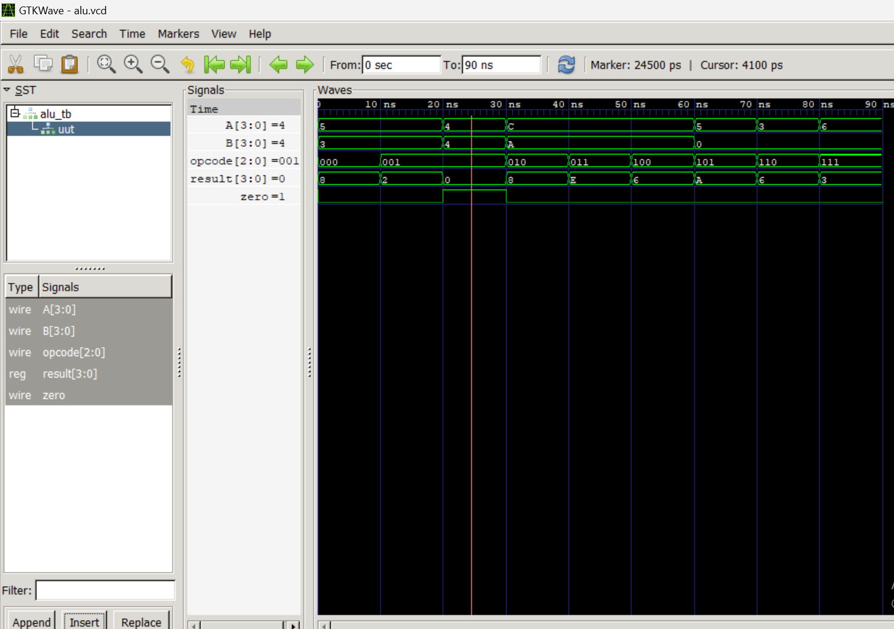

# Mini ALU (Arithmetic Logic Unit)

An 8-operation 4-bit ALU implemented in Verilog with a zero flag.

## Operations

| Opcode | Operation | Example |
|--------|-----------|---------|
| 000 | ADD | 5 + 3 = 8 |
| 001 | SUB | 5 - 3 = 2 |
| 010 | AND | 1100 & 1010 = 1000 |
| 011 | OR  | 1100 \| 1010 = 1110 |
| 100 | XOR | 1100 ^ 1010 = 0110 |
| 101 | NOT | ~0101 = 1010 |
| 110 | LEFT SHIFT | 0011 << 1 = 0110 |
| 111 | RIGHT SHIFT | 0110 >> 1 = 0011 |

## Module Details

| Signal | Width | Direction | Description |
|--------|-------|-----------|-------------|
| A | 4-bit | Input | First operand |
| B | 4-bit | Input | Second operand |
| opcode | 3-bit | Input | Operation selector |
| result | 4-bit | Output | Operation result |
| zero | 1-bit | Output | High when result = 0 |

## Zero Flag

The zero flag goes HIGH when result equals 0000. Used in
real processors for conditional branching — every if statement
and loop ultimately becomes a subtraction followed by a zero
flag check at the hardware level.

## Simulation Output



## How To Simulate

```bash
iverilog -o alu.vvp alu.v alu_tb.v
vvp alu.vvp
gtkwave alu.vcd
```

## Key Concepts
- Combinational logic (no clock needed)
- always @(*) vs always @(posedge clk)
- Blocking assignment in combinational blocks
- Zero flag and its role in processor decision making
- Shift operations as free multiplications in hardware

## Tools Used
- Icarus Verilog
- GTKWave  
- VS Code