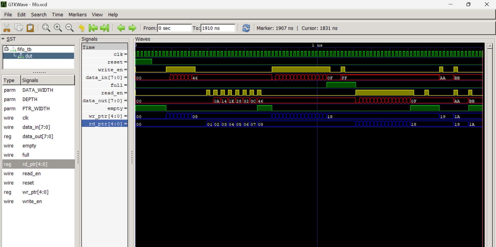

# Synchronous FIFO (First In, First Out Buffer)

A parameterizable synchronous FIFO implemented in Verilog using the N+1 pointer
trick for unambiguous full and empty detection. Both read and write operations
are clocked on the same clock signal. Verified with 6 directed tests covering
normal operation, overflow protection, underflow protection, and simultaneous
read-write.

---

## What Is a FIFO?

A FIFO is a hardware queue — data written first is read out first. It sits
between two blocks that operate at different speeds, decoupling the producer
from the consumer. Example: a CPU producing data faster than a UART can
transmit it. The FIFO absorbs the burst, the UART drains it at its own pace.

---

## Architecture

```
     clk ──────────────────────────────┐
     reset ────────────────────────┐   │
                                   │   │
write_en ──┐                       │   │
data_in ───┤                       ▼   ▼
           │              ┌─────────────────────┐
           │              │   always @(posedge  │
           └─────────────►│   clk / reset)      │
                          │                     │
                          │   WRITE POINTER     ├──► full
                          │   wr_ptr [4:0]      │
                          │                     │
                          │   mem [0:15]        │
                          │   16 × 8-bit slots  │
                          │                     │
                          │   READ POINTER      ├──► empty
                          │   rd_ptr [4:0]      │
                          │                     │
read_en ─────────────────►│   always @(posedge  │
                          │   clk / reset)      │
                          └──────────┬──────────┘
                                     │
                                     ▼
                               data_out [7:0]
```

Single module. No submodules. Separate always blocks for read and write —
both fire on posedge clk, enabling safe simultaneous read-write in one cycle.

---

## Parameters

| Parameter | Default | Description |
|-----------|---------|-------------|
| DATA_WIDTH | 8 | Width of each data slot in bits |
| DEPTH | 16 | Number of slots in the FIFO |

PTR_WIDTH is auto-calculated: `localparam PTR_WIDTH = $clog2(DEPTH)`
No manual setting. Change DEPTH — pointer width adjusts automatically.

---

## Port List

| Signal | Width | Direction | Description |
|--------|-------|-----------|-------------|
| clk | 1-bit | Input | System clock — all ops on posedge |
| reset | 1-bit | Input | Async active-HIGH reset |
| write_en | 1-bit | Input | Write enable — blocked when full |
| read_en | 1-bit | Input | Read enable — blocked when empty |
| data_in | DATA_WIDTH | Input | Data to write |
| data_out | DATA_WIDTH | Output | Data read out (1 cycle latency) |
| full | 1-bit | Output | HIGH when all slots occupied |
| empty | 1-bit | Output | HIGH when no slots occupied |

---

## The N+1 Pointer Trick

The fundamental challenge: when FIFO is empty AND when it is full, the lower
N bits of wr_ptr and rd_ptr look identical. A 4-bit pointer alone cannot
distinguish these two conditions for a 16-slot FIFO.

**Solution:** use 5-bit pointers for a 16-slot FIFO. The extra MSB is a
lap counter — it flips each time a pointer wraps from slot 15 back to slot 0.

```
Pointer structure:   [4]  |  [3:0]
                  lap bit | slot address
```

```
EMPTY: wr_ptr == rd_ptr
       Both lap bits equal, same slot
       Example: wr = 0_1000
                rd = 0_1000  → identical → EMPTY

FULL:  wr_ptr[4] != rd_ptr[4]  AND  wr_ptr[3:0] == rd_ptr[3:0]
       Lap bits differ, same slot — wr lapped rd exactly once
       Example: wr = 1_1000
                rd = 0_1000  → lapped → FULL
```

```verilog
assign empty = (wr_ptr == rd_ptr);

assign full  = (wr_ptr[PTR_WIDTH]     != rd_ptr[PTR_WIDTH]) &&
               (wr_ptr[PTR_WIDTH-1:0] == rd_ptr[PTR_WIDTH-1:0]);
```

---

## Pointer Trace — Full Simulation Cycle

```
Initial:        wr=0x00  rd=0x00  empty=1
After TEST 1 writes (8):  wr=0x08  rd=0x00
After TEST 1 reads  (8):  wr=0x08  rd=0x08  empty=1
After TEST 2 writes (16): wr=0x18  rd=0x08  full=1
  (0x18=24, 0x08=8: MSBs differ[1≠0], lower bits equal[1000==1000])
After TEST 3 reads  (16): wr=0x18  rd=0x18  empty=1
  (both 24: identical → empty)
After TEST 4:             wr=0x1A  rd=0x1A  empty=1
```

---

## Testbench Strategy

**Drive-after-posedge methodology:**
Signals are set AFTER a posedge, captured by the DUT at the NEXT posedge.
This gives nearly a full clock period (20ns) of setup time — zero race conditions.

```
@(posedge clk); write_en=1; data_in=X;   // set after posedge N
@(posedge clk); write_en=0;              // DUT captures at posedge N+1
```

---

## Tests and Results

| Test | Operation | Pass Criteria | What It Proves |
|------|-----------|---------------|----------------|
| TEST 1 | Write 8, read 8 | READ[i] == i×10 for all i | FIFO order preserved |
| TEST 2 | Fill 16 slots | full=1, empty=0 | N+1 full detection correct |
| TEST 5 | Write when full | full still=1 | Overflow protection works |
| TEST 3 | Read 16 slots | empty=1, full=0 | N+1 empty detection after wrap |
| TEST 6 | Read when empty | empty still=1 | Underflow protection works |
| TEST 4 | Simultaneous R/W | out=0xAA then 0xBB | Concurrent operation safe |

---

## Simulation Output

```
=========================================
      FIFO VERIFICATION TESTBENCH
  DEPTH=16 | DATA_WIDTH=8 bits
=========================================

[TEST 1] Write 8 bytes, read back — verify FIFO order
  READ[0] =   0  (expected   0)  PASS
  READ[1] =  10  (expected  10)  PASS
  READ[2] =  20  (expected  20)  PASS
  READ[3] =  30  (expected  30)  PASS
  READ[4] =  40  (expected  40)  PASS
  READ[5] =  50  (expected  50)  PASS
  READ[6] =  60  (expected  60)  PASS
  READ[7] =  70  (expected  70)  PASS

[TEST 2] Fill FIFO to FULL (16 bytes)
  full  = 1  (expected 1)  PASS
  empty = 0  (expected 0)  PASS

[TEST 5] Overflow attempt — write when FULL
  full still = 1  (expected 1)  PASS

[TEST 3] Empty FIFO completely (16 reads)
  empty = 1  (expected 1)  PASS
  full  = 0  (expected 0)  PASS

[TEST 6] Underflow attempt — read when EMPTY
  empty still = 1  (expected 1)  PASS

[TEST 4] Simultaneous read and write
  Simultaneous: data_out=0xaa  (expected 0xaa)  PASS
  Follow-up:    data_out=0xbb  (expected 0xbb)  PASS

=========================================
         VERIFICATION COMPLETE
=========================================
```

## GTKWave Waveform



wr_ptr advances ahead of rd_ptr during writes. rd_ptr chases during reads.
When they meet (same 5-bit value), empty fires. When wr_ptr laps rd_ptr
(MSBs differ, lower bits equal), full fires.

---

## How To Simulate

```bash
iverilog -o fifo.vvp fifo.v fifo_tb.v
vvp fifo.vvp
gtkwave fifo.vcd
```

Change depth without touching source:
```verilog
fifo #(.DATA_WIDTH(16), .DEPTH(32)) my_fifo ( ... );
```

PTR_WIDTH auto-adjusts to $clog2(32)=5, pointers become 6 bits. Works correctly.

---

## Key Concepts

- **N+1 pointer trick** — extra MSB lap counter disambiguates full from empty
- **$clog2** — compile-time pointer width calculation, zero manual maintenance
- **Circular buffer** — pointer wraps via natural binary overflow, no logic needed
- **Separate always blocks** — read and write are fully independent, safe concurrent access
- **Overflow guard** — `write_en && !full` prevents silent data corruption
- **Underflow guard** — `read_en && !empty` prevents garbage reads
- **Standard latency** — data_out valid one cycle after read_en asserted

---

## Tools Used
- Icarus Verilog (simulation)
- GTKWave (waveform viewer)
- VS Code + Verilog HDL extension

---

## Simulation Log
See [output/simulation_log.txt](output/simulation_log.txt) for full terminal output.

