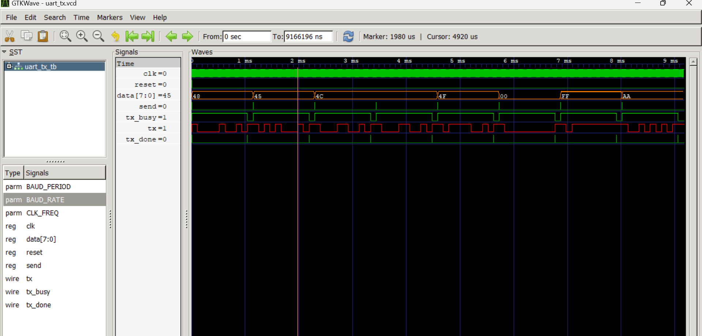

# UART Transmitter (8N1 / 8E1 / 8O1)

A fully parameterizable, multi-module UART transmitter implemented in Verilog.
Supports configurable baud rate, clock frequency, parity modes, and stop bits.
Verified by transmitting "HELLO" in ASCII plus edge cases — entirely on-device
with no external dependencies.

---

## Architecture

Three-module hierarchy:

```
uart_tx_tb (testbench)
└── uut: uart_tx (top-level transmitter)
    └── baud_inst: baud_gen (baud rate generator)
```

**baud_gen.v** — Dedicated baud rate generator. Counts clock cycles and fires
a single-cycle tick pulse at the configured baud rate. Decouples timing
generation from transmission logic.

**uart_tx.v** — 6-state Moore FSM. Captures input byte, shifts bits out
serially, handles parity computation and stop bit generation.

**uart_tx_tb.v** — Sends ASCII "HELLO" + three edge cases. Uses a reusable
`send_byte` task and event-driven `@(posedge tx_done)` waiting.

---

## Parameters

| Parameter | Default | Description |
|-----------|---------|-------------|
| CLK_FREQ | 50_000_000 | System clock frequency in Hz |
| BAUD_RATE | 9600 | Bits per second |
| PARITY | 0 | 0 = None, 1 = Even, 2 = Odd |
| STOP_BITS | 1 | 1 or 2 stop bits |

Baud divider auto-calculated: `DIVIDER = (CLK_FREQ / BAUD_RATE) - 1 = 5207`

---

## Module Details

### baud_gen.v

| Signal | Direction | Description |
|--------|-----------|-------------|
| clk | Input | System clock |
| reset | Input | Async active-HIGH reset |
| tick | Output | Single-cycle pulse at baud rate |

### uart_tx.v

| Signal | Width | Direction | Description |
|--------|-------|-----------|-------------|
| clk | 1-bit | Input | System clock |
| reset | 1-bit | Input | Async active-HIGH reset |
| send | 1-bit | Input | Pulse HIGH to trigger transmission |
| data | 8-bit | Input | Byte to transmit, captured on send |
| tx | 1-bit | Output | Serial data output line |
| tx_busy | 1-bit | Output | HIGH during entire transmission |
| tx_done | 1-bit | Output | Single-cycle pulse on completion |

---

## FSM State Diagram

```
       
      IDLE ──(send=1)──► START ──► DATA (×8 bits) 
                                     │
                (PARITY = 0[none])──┤ ├──(PARITY = 1or2[odd/even])
                        │                        ↓
                        │                       PAR
                        └────────► STOP1 ◄───────┘
                                     │
                               (STOP_BITS=2)
                                     ↓
                                   STOP2 ──► IDLE

```

| State | tx Line | Duration | Action |
|-------|---------|----------|--------|
| IDLE | HIGH | Until send=1 | Waits for trigger |
| START | LOW | 1 baud period | Start bit |
| DATA | bit[n] | 8 baud periods | Shifts out LSB first |
| PAR | parity | 1 baud period | Even or odd parity bit |
| STOP1 | HIGH | 1 baud period | Stop bit, asserts tx_done |
| STOP2 | HIGH | 1 baud period | Second stop bit |

---

## UART Frame Format (8N1)

```
IDLE  START  D0  D1  D2  D3  D4  D5  D6  D7  STOP
HIGH   LOW   b0  b1  b2  b3  b4  b5  b6  b7  HIGH

104.17µs per bit
Frame = 10 bit periods × 104.17µs = 1.04ms per byte @ 9600 baud
```

Data transmitted LSB first (D0 → D7) per UART protocol standard.

---

## Simulation Output

### Terminal

```
=== UART Transmitter Testbench ===
CLK: 50000000 Hz | BAUD: 9600 | Period: 104166 ns

Sending: H E L L O
---------------------------
Sent: H (0x48)
Sent: E (0x45)
Sent: L (0x4C)
Sent: L (0x4C)
Sent: O (0x4F)

Edge Cases:
---------------------------
Sent: 0x00 (all zeros)
Sent: 0xFF (all ones)
Sent: 0xAA (alternating)

=== Simulation Complete ===
```

### GTKWave Waveform



Eight complete UART frames visible — "HELLO" (0x48, 0x45, 0x4C, 0x4C, 0x4F)
followed by edge cases (0x00, 0xFF, 0xAA). data[7:0] shows hex values
changing per byte. tx line shows actual serial bitstream with start/stop bits.
tx_busy HIGH during transmission. tx_done single-cycle pulse on completion.

---

## Edge Cases Verified

| Byte | Binary | Purpose |
|------|--------|---------|
| 0x00 | 00000000 | All zeros — verifies stop bit returns line HIGH |
| 0xFF | 11111111 | All ones — verifies start bit pulls line LOW |
| 0xAA | 10101010 | Alternating — stresses shift register transitions |

---

## How To Simulate

```bash
# Compile all three modules
iverilog -o uart_tx.vvp baud_gen.v uart_tx.v uart_tx_tb.v

# Run simulation
vvp uart_tx.vvp

# View waveforms
gtkwave uart_tx.vcd
```

Reconfigure baud rate or clock without touching source:
```verilog
uart_tx #(
    .CLK_FREQ(100_000_000),
    .BAUD_RATE(115200),
    .PARITY(1),
    .STOP_BITS(2)
) my_uart ( ... );
```

---

## Key Concepts

- **Parameterizable RTL** — CLK_FREQ, BAUD_RATE, PARITY, STOP_BITS all
  configurable at instantiation. DIVIDER auto-calculated at compile time.
- **Multi-module hierarchy** — baud_gen instantiated inside uart_tx.
  Timing generation decoupled from FSM logic.
- **Moore FSM** — outputs depend only on current state, not inputs.
  Glitch-free, predictable output transitions.
- **Reduction XOR** — `^data` computes parity across all 8 bits in one
  operation. Same as `data[7]^data[6]^...^data[0]`.
- **Single-cycle pulse** — tx_done uses default-LOW pattern: set LOW every
  cycle by default, explicitly HIGH only in STOP states. Guaranteed one cycle.
- **Event-driven testbench** — `@(posedge tx_done)` waits for actual
  hardware signal rather than fixed delay. Works at any baud rate.
- **Shift register** — `tx <= shift_reg[0]; shift_reg <= shift_reg >> 1`
  drives LSB onto tx then shifts right. Non-blocking ensures correct ordering.

---

## Tools Used

- Icarus Verilog (simulation)
- GTKWave (waveform viewer)
- VS Code + Verilog HDL extension

---

## Protocol Reference

- Standard: ITU-T V.24 / EIA-232
- Frame format: 8N1 (default), 8E1, 8O1 (configurable)
- Baud rate: 9600 (default), any rate supported via parameters
- Bit order: LSB first per UART standard

